# NEBULA X 2.0 — PHASE 3: EDUCATIONAL QUALITY SPECIFICATION & PEDAGOGICAL FRAMEWORK

**Project:** NEBULA X — The Forgotten Space Archive  
**Challenge:** 2026 NASA Space Apps Challenge · "Abandoned but not Forgotten: Storytelling about NASA's Discarded Equipment on the Moon and Mars"  
**Repository:** https://github.com/gowtham-ks/nebula-x-2.0  
**Phase:** Phase 3 — Educational Quality & Pedagogical Design  
**Priority:** P2 — High  
**Status:** COMPLETED & VERIFIED  

---

## 1. TARGET AUDIENCE & CURRICULUM ALIGNMENT

NEBULA X 2.0 is engineered specifically for **secondary education students (Ages 13–18, Grades 8–12)**, introductory undergraduate astronomy students, and public museum visitors.

### Pedagogical Standards Alignment:
- **Next Generation Science Standards (NGSS):**
  - *MS-ESS1-3 / HS-ESS1-4:* Analyze and interpret data to determine scale properties of objects in the solar system; Kepler's laws and orbital mechanics.
  - *MS-PS2-4 / HS-PS2-1:* Gravitational interactions, rocket thrust, hypergolic propulsion, momentum conservation.
  - *MS-ETS1-2 / HS-ETS1-3:* Engineering design trade-offs (mass budgets, thermal insulation, non-rechargeable silver-zinc vs solar vs RTG power).
- **Secondary School Science Competencies:**
  - Reading authentic scientific datasets and technical catalogs.
  - Distinguishing documented empirical observations from theoretical models.
  - Understanding planetary geology (regolith composition, basaltic volcanism, water-ice frost, dust storms).
  - Tracing space-to-Earth technological spinoffs.

---

## 2. CORE EDUCATIONAL OBJECTIVES

Students engaging with NEBULA X achieve five primary learning outcomes:

1. **Understand Mission Purpose & Engineering Trade-Offs:**  
   Students learn why spacecraft were engineered with specific physical architectures (e.g., why Apollo lunar modules left descent stages behind as launch pads, why Surveyors used crushable honeycomb landing pads, and why rovers require dust wipers or RTGs).

2. **Spatial & Cartographic Literacy:**  
   Students explore real spherical coordinates across the lunar near-side maria and highlands, Martian volcanic plains and outflow channels, and interplanetary escape trajectories, recognizing why specific landing sites (Tranquility Base, Ocean of Storms, Chryse Planitia, Jezero Crater) were scientifically targeted.

3. **Critical Epistemic Literacy (Fact vs Interpretation vs Dramatization):**  
   Students learn how scientific knowledge is produced. They learn to differentiate between directly recorded telemetry (`DOCUMENTED FACT`), conclusions drawn from sensor data (`SCIENTIFIC INTERPRETATION`), and narrative engagement devices (`EDUCATIONAL DRAMATIZATION`).

4. **Principles of Space Archaeology:**  
   Students examine how the extraterrestrial space environment (cosmic radiation, extreme thermal cycles from −170°C to +120°C, high-velocity micrometeoroids, electrostatic regolith levitation) affects artifacts left on airless worlds versus thin-atmosphere worlds.

5. **Technological Heritage & Human Value:**  
   Students trace how exploratory hardware breakthroughs directly generated everyday civilian technologies (e.g., CMOS active pixel sensors, shock-absorbing foam, water filtration, telemetry communication algorithms).

---

## 3. THE 7-QUESTION EDUCATIONAL SCHEMA

To provide a consistent, structured pedagogical inquiry framework across all 13 equipment groups, every entry in `src/machinesData.js` implements the **7 Core Space Archaeology Questions**:

| # | Pedagogical Question | Focus Area | Educational Purpose |
| :-: | :--- | :--- | :--- |
| **01** | **What is it?** | Physical Identity & Subsystems | Explains the physical machinery, mass, power source, and structure without confusing jargon. |
| **02** | **Why was it sent?** | Historical & Scientific Mandate | Connects the machine to historical mission goals and NASA program objectives. |
| **03** | **How did it work?** | Operational Physics & Mechanics | Explains rocket propulsion, solar arrays, battery chemistry, telemetry antennae, and sensors. |
| **04** | **What did it discover?** | Empirical Scientific Findings | Highlights peer-reviewed scientific breakthroughs, sample masses, photos, and spectrometry. |
| **05** | **What happened to it?** | Final Status & Resting State | Details mission termination, signal loss, component exhaustion, or deliberate impact. |
| **06** | **Why does it matter today?** | Legacy & Archaeological Value | Explains why the abandoned hardware remains culturally and scientifically vital. |
| **07** | **Did we learn something unexpected?** | Anomaly & Serendipitous Science | Highlights surprising discoveries (e.g. horizontal dust blowing at touchdown, dust-clearing wind gusts, laser reflections). |

---

## 4. CONTENT CLASSIFICATION TAXONOMY

To teach secondary students scientific rigor, NEBULA X visually classifies all textual statements into four distinct epistemological tiers:

### 1. `DOCUMENTED FACT` (Emerald Badge · `<ShieldCheck />`)
- **Definition:** Directly documented, empirically recorded data points with verifiable NASA catalog citations.
- **Examples:**
  - Apollo 11 Lunar Module Descent Stage resting coordinates: 0.67408° N, 23.47297° E (NSSDCA ID 1969-059C).
  - Sojourner rover traversed 104 meters across Ares Vallis between July 4 and September 27, 1997.
  - Opportunity rover signal terminated in June 2018 during a global Martian dust storm.

### 2. `SCIENTIFIC INTERPRETATION` (Cyan Badge · `<Sparkles />`)
- **Definition:** Hypotheses, scientific conclusions, or geochemical models derived from sensor telemetry, spectrometry, and geological sample analyses.
- **Examples:**
  - Hematite "blueberries" in Eagle Crater indicating past liquid, acidic groundwater environments.
  - Radar reflections and neutron spectrometer dips interpreted as subsurface water-ice deposits.
  - Martian atmospheric methane fluctuations representing seasonal geochemical or biological processes.

### 3. `EDUCATIONAL DRAMATIZATION` (Amber Badge · `<BookOpen />`)
- **Definition:** First-person retrospective memoirs and imaginative dialogues crafted for narrative empathy and youth engagement.
- **Governance:** Every dramatization is preceded by an explicit disclaimer:  
  *“First-person voice memoirs are dramatized for educational engagement. All operational dates, resting locations, coordinates, and scientific achievements are verified against official NASA NSSDCA catalogs.”*

### 4. `UNVERIFIED` (Gray/Warning Badge · `<Info />`)
- **Definition:** Claims that lack direct authorization or citation in the 2026 Space Apps Challenge Resources tab.
- **Rule:** If a claim cannot be verified via official NSSDCA mission catalogs, it is flagged as UNVERIFIED rather than invented.

---

## 5. MULTIMODAL ACCESSIBILITY & UNIVERSAL DESIGN FOR LEARNING (UDL)

NEBULA X 2.0 incorporates the Universal Design for Learning (UDL) framework to accommodate diverse student needs:

```mermaid
flowchart TD
  UDL[Universal Design for Learning]
  UDL --> Visual[Visual Representation]
  UDL --> Auditory[Auditory Engagement]
  UDL --> Textual[Textual & A11y Support]
  UDL --> Kinesthetic[Interactive Discovery]

  Visual --> V1[Interactive 3D Textured Celestial Globes]
  Visual --> V2[Authentic 16:9 NSSDCA Photographic Archives]
  Visual --> V3[High-DPI 1600x1130 Canvas Certificate]

  Auditory --> A1[Speech Synthesis Transmission Narration]
  Auditory --> A2[Speed Slider 0.8x - 1.4x]
  Auditory --> A3[Subtle Ambient Frequency Drone]

  Textual --> T1[Readable Full-Text Transcript Without Audio]
  Textual --> T2[Synchronized Live Subtitle Banner]
  Textual --> T3[Keyboard Navigation & Escape Handler]

  Kinesthetic --> K1[Interactive Telemetry Evidence Scanner]
  Kinesthetic --> K2[Mission Control Anomaly Case Quizzes]
  Kinesthetic --> K3[Side-by-Side Equipment Comparison Lab]
```

1. **For Deaf and Hard-of-Hearing Students:**
   - A dedicated **"READABLE TRANSCRIPT (NO AUDIO REQUIRED)"** panel renders the complete verbatim text of every transmission with reading markers, word counts, and citations.
   - Live synchronized subtitle captions display spoken phrases in high-contrast text.
2. **For Neurodivergent Students & Variable Pacing:**
   - Playback rate slider allows slowing speech to 0.8× or speeding up to 1.4×.
   - Pause, resume, and replay buttons allow students to process information at their own pace.
   - Content is divided into bite-sized cards rather than overwhelming text walls.
3. **For Low-Vision and Motor-Impaired Students:**
   - High-contrast color scheme (Deep Void Black `#05070F` with electric blue `#38BDF8` and crisp typography).
   - Keyboard accessibility (`Tab`, `Shift+Tab`, `Enter`, `Space`, `Escape`).
   - Distinct `:focus-visible` outline rings (`2px solid #38BDF8`).
   - Accessible HTML fallback buttons beneath 3D scenes for non-mouse users.

---

## 6. COMPLETE EDUCATIONAL SCHEMA MATRIX (13 EQUIPMENT GROUPS)

| Machine | Target Celestial Body | NSSDCA Catalog ID | 7-Question Student Guide | Content Badges |
| :--- | :--- | :--- | :---: | :---: |
| **Apollo Lunar Modules** | Moon (6 Sites) | `APOLLO-LM-DESCENT-STAGES` | Complete (7/7) | Verified Fact / Dramatization |
| **Apollo LRV Buggies** | Moon (3 Sites) | `APOLLO-LRV` | Complete (7/7) | Verified Fact / Dramatization |
| **Apollo ALSEP Stations** | Moon (5 Sites) | `APOLLO-ALSEP` | Complete (7/7) | Verified Fact / Interpretation |
| **Robotic Surveyors** | Moon (5 Sites) | `SURVEYOR-PROGRAM` | Complete (7/7) | Verified Fact / Interpretation |
| **Sojourner Rover** | Mars (Ares Vallis) | `1996-068A` | Complete (7/7) | Verified Fact / Interpretation |
| **Spirit & Opportunity** | Mars (2 Sites) | `MER-A-B` | Complete (7/7) | Verified Fact / Interpretation |
| **Viking 1 & 2 Landers** | Mars (2 Sites) | `VIKING-1-2-LANDERS` | Complete (7/7) | Verified Fact / Interpretation |
| **Phoenix & InSight** | Mars (2 Sites) | `PHOENIX-INSIGHT` | Complete (7/7) | Verified Fact / Interpretation |
| **Ingenuity Mars Helicopter** | Mars (Jezero Crater) | `2020-052C` | Complete (7/7) | Verified Fact / Interpretation |
| **Dawn Spacecraft** | Ceres (Dwarf Planet Orbit) | `2007-043A` | Complete (7/7) | Verified Fact / Interpretation |
| **NEAR Shoemaker** | 433 Eros (Asteroid Surface) | `1996-008A` | Complete (7/7) | Verified Fact / Interpretation |
| **Pioneer 10 & 11** | Interstellar Space (2 Vectors)| `PIONEER-10-11` | Complete (7/7) | Verified Fact / Interpretation |
| **Kepler Space Telescope** | Heliocentric Earth-Trailing Orbit| `2009-011A` | Complete (7/7) | Verified Fact / Interpretation |

*All 13 equipment groups verified and deployed in application runtime.*
